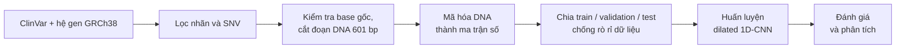

# PathoGen: dự đoán tính gây bệnh của đột biến SNV từ chuỗi DNA

PathoGen là mô hình học sâu dự đoán một đột biến đơn nucleotide (SNV) là gây bệnh hay lành tính, chỉ dựa vào đoạn DNA quanh vị trí đột biến.

**Bối cảnh.** Khi giải trình tự gen của một người, ta tìm thấy hàng triệu vị trí khác với hệ gen chuẩn. Phần lớn trong số đó chưa ai biết là có hại hay không, và kiểm tra bằng thí nghiệm thì tốn kém. Một mô hình dự đoán tốt giúp chọn ra những đột biến đáng nghi để ưu tiên kiểm tra.

**Project làm gì:**

- Huấn luyện mô hình trên khoảng 1.4 triệu đột biến đã có nhãn trong ClinVar, kèm đoạn DNA lấy từ hệ gen chuẩn GRCh38.
- Chia train/test theo vùng trên hệ gen và theo thời gian (train trên dữ liệu cũ, test trên đột biến mới), để điểm số không bị ảo do tập test quá giống tập train.
- Kiểm tra xem mô hình thật sự dựa vào chính đột biến hay chỉ đang nhớ vùng gen.

BTL INT3423 Tin sinh học ứng dụng. Nhóm: Phùng Tiến Dũng, Dương Đình Minh.

**Kết quả chính:** trên tập test gồm những vùng hệ gen mà mô hình chưa thấy khi huấn luyện, mô hình phát hiện 83.9% đột biến gây bệnh và nhận đúng 97.1% đột biến lành tính.



## 1. Định nghĩa bài toán

**Đột biến đơn nucleotide (SNV)** là một vị trí trên DNA mà một base (A, C, G hoặc T) bị thay bằng base khác. Base trên hệ gen tham chiếu gọi là **REF**, base sau đột biến gọi là **ALT**. Ví dụ đột biến C→T có REF = C, ALT = T.

Nhãn lấy từ **ClinVar**, cơ sở dữ liệu công khai của NCBI (Mỹ), nơi các phòng xét nghiệm và nhóm chuyên gia ghi nhận đột biến kèm đánh giá lâm sàng. Bài toán là phân loại nhị phân:

| Phân loại trong ClinVar | Nhãn |
|---|---|
| Benign, Likely benign (lành tính, có khả năng lành tính) | 0 |
| Pathogenic, Likely pathogenic (gây bệnh, có khả năng gây bệnh) | 1 |

Các phân loại không thuộc rõ về nhóm nào bị bỏ: Uncertain significance (chưa rõ ý nghĩa), Conflicting classifications (các nguồn đánh giá mâu thuẫn), drug response, risk factor…

Đầu vào của mô hình chỉ là đoạn DNA quanh đột biến, lấy từ hệ gen tham chiếu GRCh38. Mô hình không dùng thông tin nào khác như độ bảo tồn tiến hóa, tần số đột biến trong quần thể hay chú thích gen.

**Đo kết quả.** Chỉ 11.8% đột biến trong dữ liệu là gây bệnh. Các chỉ số dùng trong README:

- **Precision:** trong các đột biến mô hình gắn cờ gây bệnh, bao nhiêu phần trăm thực sự gây bệnh.
- **Recall:** trong các đột biến thực sự gây bệnh, mô hình tìm ra được bao nhiêu phần trăm.
- **F1:** trung bình điều hòa của precision và recall.
- **ROC-AUC:** xác suất một đột biến gây bệnh chọn ngẫu nhiên được chấm điểm cao hơn một đột biến lành tính chọn ngẫu nhiên. Đoán ngẫu nhiên được 0.5.
- **PR-AUC** (average precision): trung bình precision tại vị trí xếp hạng của từng đột biến gây bệnh. Đoán ngẫu nhiên được đúng bằng tỉ lệ đột biến gây bệnh trong tập đang đo. Đây là chỉ số chính của project, vì nó tập trung vào nhóm gây bệnh, vốn chỉ chiếm phần nhỏ dữ liệu.

Precision, recall và F1 phụ thuộc vào ngưỡng điểm dùng để gắn cờ; ROC-AUC và PR-AUC thì không.

## 2. Pipeline dữ liệu

**Nguồn dữ liệu**

- **ClinVar** `variant_summary.txt`: bảng tổng hợp mọi biến thể ClinVar ghi nhận, gồm vị trí, loại biến thể, REF/ALT, phân loại lâm sàng và *review status* (mức độ tin cậy của đánh giá). Project dùng bản phát hành tháng 5/2026; bản tháng 12/2022 được dùng thêm cho phép chia theo thời gian ở mục 4.4.
- **GRCh38**: hệ gen tham chiếu của người, ở dạng file FASTA (file văn bản chứa chuỗi DNA của từng nhiễm sắc thể), bản lắp ráp RefSeq `GCF_000001405.26` của NCBI.

**Bước 1: Lọc nhãn và SNV**

- Chỉ giữ biến thể có tọa độ trên GRCh38 và có loại là SNV.
- REF và ALT phải là một trong bốn base A, C, G, T.
- Chỉ giữ phân loại map được sang nhãn 0 hoặc 1 (mục 1).
- Chỉ giữ review status có tiêu chí đánh giá (criteria provided, reviewed by expert panel, practice guideline). Bỏ "no assertion criteria provided", tức đánh giá không kèm tiêu chí.

**Bước 2: Kiểm tra REF**

Trong file FASTA, mỗi nhiễm sắc thể mang tên theo mã RefSeq kèm số phiên bản, ví dụ nhiễm sắc thể 1 là `NC_000001.11`, nhiễm sắc thể X là `NC_000023.11`. Pipeline đổi tên nhiễm sắc thể trong ClinVar sang mã này, đọc base tại vị trí đột biến trong FASTA và so với REF của ClinVar. Biến thể không khớp bị loại, vì khi đó tọa độ trong ClinVar và hệ gen tham chiếu không nhất quán.

**Bước 3: Cắt đoạn DNA 601 bp**

Với mỗi đột biến, lấy 300 bp (cặp base) bên trái, base tại vị trí đột biến và 300 bp bên phải, tổng cộng 601 bp. Bị loại: đột biến nằm quá sát đầu hoặc cuối nhiễm sắc thể (không đủ 601 bp), và đoạn chứa ký tự ngoài A/C/G/T (ví dụ N, vị trí chưa xác định được base). Lý do chọn độ dài 601 bp ở mục 5.2.

| Sau bước | Số biến thể |
|---|---:|
| Lọc nhãn, SNV và kiểm tra REF | 1,426,477 |
| Cắt đoạn 601 bp | 1,426,427 |
| Trong đó lành tính (nhãn 0) | 1,257,967 |
| Trong đó gây bệnh (nhãn 1) | 168,460 (11.8%) |

## 3. Biểu diễn đặc trưng

Mạng nơ-ron chỉ nhận số, nên mỗi base được mã hóa **one-hot**: A = [1,0,0,0], C = [0,1,0,0], G = [0,0,1,0], T = [0,0,0,1]. Một đoạn 601 bp trở thành ma trận 601 × 4; mỗi cột gọi là một **kênh**. Project thử các cách đưa thông tin đột biến vào mạng như sau.

**One-hot REF/ALT.** 4 kênh cho chuỗi REF (chuỗi gốc) và 4 kênh cho chuỗi ALT (chuỗi gốc nhưng base tại tâm được thay bằng ALT).

**Mutation marker.** Thêm 1 kênh bằng 1 tại vị trí đột biến và bằng 0 ở mọi vị trí khác. One-hot REF/ALT cùng marker tạo thành đầu vào **dense 9 kênh**.

**Positional encoding.** Thêm 8 kênh là các hàm sin/cos theo vị trí (sinusoidal), cho mạng biết mỗi vị trí nằm ở đâu trong đoạn 601 bp. Dense 9 kênh cộng 8 kênh này thành 17 kênh.

**Compact.** Phần tích chập chỉ nhận chuỗi REF (4 kênh). Thông tin đột biến là một vector 8 số (one-hot của REF và của ALT tại tâm), chỉ được ghép vào ở cuối mạng, ngay trước lớp phân loại. Cách ghép muộn này gọi là *late fusion*. Có thêm hai biến thể đưa vector đột biến vào bên trong phần tích chập:

- **SE gate:** vector đột biến sinh ra một hệ số nhân cho từng kênh đặc trưng.
- **FiLM:** vector đột biến sinh ra hệ số nhân γ và hệ số cộng β cho từng kênh, ở mọi lớp dilated (mục 5.2).

**Sparse ALT.** 4 kênh REF trên toàn đoạn, cộng 4 kênh ALT chỉ có giá trị tại vị trí đột biến và bằng 0 ở 600 vị trí còn lại, tổng 8 kênh. Ví dụ với đột biến C→T, kênh REF-C và kênh ALT-T cùng bằng 1 tại vị trí 301.

| Biểu diễn | Số kênh | Thông tin đột biến đi vào mạng ở đâu |
|---|---|---|
| Dense REF + ALT + marker | 9 (17 nếu thêm positional encoding) | Ngay lớp tích chập đầu tiên |
| Compact (late fusion) | 4 + vector 8 số | Cuối mạng, trước lớp phân loại |
| Compact + SE gate / FiLM | 4 + vector 8 số | Điều chỉnh các kênh đặc trưng bên trong phần tích chập |
| Sparse ALT | 8 | Ngay lớp tích chập đầu tiên, chỉ tại vị trí đột biến |

**Lưu trữ.** Ma trận dense 9 kênh cho 1.43 triệu đột biến chiếm 7.19 GB (mỗi giá trị 1 byte). Thay vào đó, có thể chỉ lưu chuỗi REF dưới dạng chỉ số base 0–3 (0.80 GB) kèm base ALT, rồi tạo ma trận one-hot cho từng batch khi huấn luyện. Cách này dùng được cho mọi biểu diễn ở trên.

## 4. Chia tập chống rò rỉ dữ liệu

Dữ liệu được chia thành ba tập: **train** để mô hình học, **validation** để chọn checkpoint và ngưỡng, **test** chỉ dùng để báo cáo kết quả cuối. **Rò rỉ dữ liệu** xảy ra khi tập test chứa thông tin mà mô hình đã thấy lúc train, làm điểm test cao hơn thực tế. Với DNA, hai đột biến nằm gần nhau có đoạn DNA xung quanh gần như trùng nhau. Nếu một đột biến ở train và đột biến kế bên ở test, mô hình có thể đoán đúng nhờ nhớ đoạn DNA chứ không phải nhờ hiểu đột biến.

Phép chia được siết dần qua bốn bước dưới đây.

### 4.1. Kiểm tra phép chia ngẫu nhiên

Chia ngẫu nhiên từng dòng dữ liệu, rồi đo mức trùng giữa train và test (trên bộ dữ liệu ban đầu, đoạn DNA 201 bp):

| Kiểm tra | Kết quả |
|---|---:|
| Đột biến trùng hoàn toàn giữa train và test | 0 |
| Gen ở tập test cũng xuất hiện trong train | 94.6% (3,709 / 3,920) |
| Đột biến test cách một đột biến train dưới 201 bp | 95.3% |
| Đoạn REF (không lặp) ở test trùng hệt một đoạn ở train | 11.6% |

95.3% đột biến test nằm cách một đột biến train dưới 201 bp, tức là đoạn DNA đầu vào của chúng chồng lên nhau. Phép chia ngẫu nhiên vì vậy không kiểm tra được khả năng dự đoán ở những vùng mô hình chưa thấy.

### 4.2. Chia theo nhóm gen

Mọi đột biến thuộc cùng một gen (`GeneSymbol`) được xếp vào cùng một tập, nên không gen nào có mặt ở hai tập. Tuy vậy, chia theo tên gen không ràng buộc khoảng cách trên hệ gen: hai gen nằm cạnh nhau hoặc chồng lên nhau có thể rơi vào hai tập khác nhau, nên đột biến rất gần nhau vẫn có thể nằm ở cả train và test.

### 4.3. Chia theo khối genome và purge

Hệ gen được cắt thành các khối dài 1 Mb (1 triệu bp), mỗi khối thuộc trọn về train, validation hoặc test. Hai đột biến nằm hai bên ranh giới khối vẫn có thể rất gần nhau, nên project **purge** (loại bỏ) thêm:

- **Theo tọa độ:** loại đột biến validation nằm cách train dưới 5 kb (5,000 bp), và đột biến test nằm cách train hoặc validation dưới 5 kb.
- **Theo chuỗi:** loại đột biến có đoạn REF 601 bp trùng hệt một đoạn ở tập trước đó (validation so với train; test so với train và validation), so khớp bằng mã băm.

| Tập | Số biến thể | Lành tính | Gây bệnh |
|---|---:|---:|---:|
| Train | 1,002,376 | 883,610 | 118,766 |
| Validation | 205,864 | 180,524 | 25,340 |
| Test | 216,351 | 192,330 | 24,021 |

Bước purge loại 1,126 đột biến validation và 710 đột biến test. Sau purge, đột biến train gần nhất cách ít nhất 5,001 bp với validation và 5,023 bp với test; trung vị lần lượt là 398,213 bp và 388,904 bp.

### 4.4. Chia theo thời gian

ClinVar được cập nhật liên tục. Khi dùng thực tế, mô hình sẽ phải dự đoán những đột biến được ghi nhận sau thời điểm huấn luyện. Phép chia này mô phỏng đúng tình huống đó: học từ dữ liệu cũ, kiểm thử trên đột biến mới.

- Dataset được dựng từ bản phát hành 2026-05, và nhãn cũng lấy từ bản này.
- Đột biến có khóa `chrom:pos:ref:alt` đã tồn tại trong bản 2022-12 thuộc train/validation. Tất cả đột biến còn lại tạo thành tập test.
- Validation là 15% đột biến cũ, tách theo khối genome và purge so với train (5 kb và đoạn REF trùng hệt).
- Các bản trùng hoàn toàn với đột biến train bị loại khỏi validation và test.
- Tập test không purge theo khoảng cách, để phản ánh đúng cách mô hình sẽ được dùng.

| Tập | Số biến thể | Lành tính | Gây bệnh |
|---|---:|---:|---:|
| Train (có trong bản 2022-12) | 610,407 | 528,009 | 82,398 (13.5%) |
| Validation (có trong bản 2022-12, khối genome tách riêng) | 102,874 | 89,121 | 13,753 (13.4%) |
| Test (mới, chỉ có trong bản 2026-05) | 586,778 | 533,674 | 53,104 (9.1%) |

## 5. Mô hình và huấn luyện

Mô hình là **mạng nơ-ron tích chập một chiều (1D-CNN)**: các bộ lọc ngắn trượt dọc đoạn DNA để nhận ra các mẫu chuỗi cục bộ (motif). Mục này đi qua từng bước phát triển: bước nào được giữ, nhánh nào bị bỏ, và vì sao.

Hai lưu ý khi đọc số liệu:

- Mục 5.1–5.3 và phần đầu mục 5.5 chạy trên bộ dữ liệu ban đầu: khoảng 460 nghìn SNV, tạo ra khi bước đổi tên nhiễm sắc thể ở mục 2 chưa khớp hết với file FASTA. Các bước này dùng phép chia ngẫu nhiên hoặc theo nhóm gen, và tính precision/recall/F1 ở ngưỡng 0.5.
- Mục 5.4 và phần sau mục 5.5 chạy trên bộ dữ liệu đầy đủ 1.43 triệu SNV, chia theo khối genome, với ngưỡng chọn trên validation.

Số liệu giữa hai giai đoạn không so trực tiếp với nhau được. Mọi kết quả dùng một seed.

### 5.1. CNN baseline

CNN ban đầu gồm 3 lớp tích chập (kernel 7, 5, 3), hai lớp max pooling xen giữa, rồi global max pooling (lấy giá trị lớn nhất của mỗi kênh trên toàn chuỗi) và 2 lớp fully connected. Đoạn DNA dài 201 bp.

| Mô hình | Đầu vào | Phép chia | ROC-AUC | PR-AUC | Precision | Recall | F1 |
|---|---|---|---:|---:|---:|---:|---:|
| CNN | Chỉ ALT (4 kênh) | Ngẫu nhiên | 0.653 | 0.245 | 0.177 | 0.639 | 0.277 |
| CNN | REF + ALT + marker (9 kênh) | Ngẫu nhiên | 0.848 | 0.522 | 0.353 | 0.723 | 0.475 |
| Transformer nhỏ | REF + ALT + marker (9 kênh) | Ngẫu nhiên | 0.802 | 0.435 | 0.295 | 0.710 | 0.417 |
| CNN | REF + ALT + marker (9 kênh) | Theo nhóm gen | 0.848 | 0.522 | 0.344 | 0.735 | 0.468 |
| CNN | + positional encoding (17 kênh) | Theo nhóm gen | 0.881 | 0.572 | 0.527 | 0.581 | 0.553 |

- **Giữ REF + ALT + marker.** Chỉ có chuỗi ALT thì mô hình không biết base gốc là gì. Thêm REF và marker làm PR-AUC tăng hơn gấp đôi (0.245 → 0.522).
- **Bỏ Transformer.** Trên cùng đầu vào và cùng phép chia, Transformer nhỏ kém CNN (PR-AUC 0.435 so với 0.522).
- **Giữ positional encoding ở giai đoạn này.** Global max pooling bỏ mất thông tin đặc trưng nằm ở vị trí nào; positional encoding bổ sung thông tin vị trí. PR-AUC tăng từ 0.522 lên 0.572.

### 5.2. Dilated 1D-CNN

Với **dilated convolution**, bộ lọc lấy mẫu cách quãng: với hệ số giãn (dilation) d, bộ lọc đọc một base sau mỗi d base. Xếp chồng các lớp có d = 1, 2, 4, …, 64 làm vùng nhìn của mỗi đặc trưng tăng theo cấp số nhân mà không cần pooling. Nhờ vậy chuỗi giữ nguyên độ dài, và đặc trưng tại tâm vẫn ứng đúng vị trí đột biến.

Kiến trúc: 1 lớp tích chập đầu (kernel 7, 64 kênh), 7 lớp dilated (kernel 7, dilation 1–64), rồi ghép ba vector (đặc trưng tại tâm, global max, global mean) đưa vào lớp phân loại. Vùng nhìn (receptive field) của mỗi đặc trưng cuối là 769 bp, phủ hết đoạn đầu vào.

| Mô hình (có positional encoding) | Đoạn DNA | ROC-AUC | PR-AUC | Precision | Recall | F1 |
|---|---|---:|---:|---:|---:|---:|
| CNN nông (mục 5.1) | 201 bp | 0.881 | 0.572 | 0.527 | 0.581 | 0.553 |
| CNN nông | 1001 bp | 0.858 | 0.570 | 0.378 | 0.769 | 0.506 |
| Dilated CNN | 1001 bp | 0.932 | 0.773 | 0.649 | 0.729 | 0.687 |
| Dilated CNN | 601 bp | 0.933 | 0.775 | 0.669 | 0.719 | 0.693 |

- **Chỉ kéo dài đoạn DNA thì không giúp.** Với CNN nông, tăng từ 201 lên 1001 bp không đổi PR-AUC (0.572 → 0.570). Mỗi đặc trưng của CNN nông chỉ nhìn được khoảng 26 bp; đoạn dài hơn chỉ có ích khi vùng nhìn của mô hình đủ lớn.
- **Giữ dilated CNN.** Cùng đoạn 1001 bp, dilated CNN tăng PR-AUC thêm 0.20 (0.570 → 0.773).
- **Chọn 601 bp thay vì 1001 bp.** Hai độ dài cho kết quả gần như bằng nhau (PR-AUC 0.775 và 0.773), nhưng dữ liệu 601 bp nhỏ hơn: 2.4 GB so với 3.9 GB cho bộ dữ liệu ban đầu ở dạng dense 9 kênh.

### 5.3. Reverse-complement augmentation và TTA

DNA có hai mạch bổ sung cho nhau (A đi với T, C đi với G) và chạy ngược chiều nhau. Cùng một đột biến có thể được viết trên mạch còn lại dưới dạng **reverse complement**: đảo ngược chuỗi và thay mỗi base bằng base bổ sung. File FASTA chỉ lưu một mạch, nên mô hình có thể học lệch theo chiều đọc đó.

- **RC augmentation:** khi huấn luyện, mỗi đoạn DNA được thay bằng reverse complement của nó với xác suất 0.5.
- **RC TTA** (test-time augmentation): khi đánh giá, dự đoán trên cả hai chiều rồi lấy trung bình.

| Mô hình (601 bp) | ROC-AUC | PR-AUC | Precision | Recall | F1 |
|---|---:|---:|---:|---:|---:|
| Dilated CNN | 0.933 | 0.775 | 0.669 | 0.719 | 0.693 |
| + RC augmentation / TTA | 0.956 | 0.843 | 0.669 | 0.819 | 0.737 |

Giữ cả hai: PR-AUC tăng từ 0.775 lên 0.843, recall từ 0.719 lên 0.819.

### 5.4. Hard-negative fine-tuning

**Mẫu âm khó** là đột biến lành tính mà mô hình đang chấm điểm cao, tức dễ bị nhầm thành gây bệnh. Sau khi huấn luyện chính, mô hình được huấn luyện thêm 2 epoch với learning rate nhỏ hơn (3e-4) trên toàn bộ mẫu dương, các mẫu âm khó và một phần mẫu âm dễ chọn ngẫu nhiên, để tập trung vào những ca dễ nhầm.

Kết quả trên bộ dữ liệu đầy đủ, chia theo khối genome (mô hình lúc này dùng đầu vào dense 9 kênh):

| Giai đoạn | PR-AUC validation | ROC-AUC validation |
|---|---:|---:|
| Sau 5 epoch huấn luyện chính | 0.894 | 0.979 |
| Sau thêm 2 epoch hard-negative | 0.905 | 0.981 |

Giữ bước này.

### 5.5. Ablation kiến trúc

**Ablation** là thử thêm, bớt hoặc thay một thành phần rồi so kết quả.

**Thêm thành phần vào dilated CNN** (bộ dữ liệu ban đầu, 601 bp, chia theo nhóm gen, đã có RC augmentation/TTA):

- *Residual connection:* cộng đầu vào của mỗi khối vào đầu ra của khối đó.
- *Relative positional encoding:* một kiểu mã hóa vị trí khác, thay cho sinusoidal.
- *Window attention:* mỗi vị trí tổng hợp thông tin từ các vị trí khác trong một cửa sổ cục bộ, đặt sau các lớp dilated.

| Thay đổi | ROC-AUC | PR-AUC | Precision | Recall | F1 | Quyết định |
|---|---:|---:|---:|---:|---:|---|
| Dilated CNN + RC (gốc) | 0.956 | 0.843 | 0.669 | 0.819 | 0.737 | |
| + residual connection | 0.949 | 0.822 | 0.720 | 0.748 | 0.734 | Bỏ |
| Relative positional encoding | 0.953 | 0.838 | 0.673 | 0.812 | 0.736 | Bỏ |
| + window attention | 0.959 | 0.851 | 0.661 | 0.844 | 0.741 | Không dùng tiếp |

- Residual connection và relative positional encoding đều làm PR-AUC giảm (0.822 và 0.838 so với 0.843) nên bị bỏ.
- Window attention chỉ tăng 0.008 PR-AUC, nhỏ hơn nhiều so với mức tăng từ dilated CNN và RC augmentation, trong khi tốn thêm tính toán, càng nhiều khi đoạn DNA dài ra. Nhánh này không được đưa sang bộ dữ liệu đầy đủ.

**Cách đưa đột biến vào mạng** (bộ dữ liệu đầy đủ, chia theo khối genome, các biểu diễn ở mục 3; precision/recall/F1 ở ngưỡng chọn trên validation):

| Biểu diễn | ROC-AUC | PR-AUC | Precision | Recall | F1 |
|---|---:|---:|---:|---:|---:|
| Dense REF + ALT + marker + positional encoding | 0.984 | 0.912 | 0.792 | 0.845 | 0.818 |
| Compact (late fusion) | 0.978 | 0.887 | 0.777 | 0.813 | 0.795 |
| Compact + SE gate | 0.978 | 0.886 | 0.778 | 0.811 | 0.794 |
| Compact + FiLM | 0.978 | 0.887 | 0.776 | 0.813 | 0.794 |
| **Sparse ALT** | **0.982** | **0.904** | **0.783** | **0.839** | **0.810** |

- **Bỏ compact (late fusion).** Phần tích chập chỉ thấy chuỗi REF, không biết base nào bị đổi. So với dense, PR-AUC giảm 0.025 và recall giảm từ 0.845 xuống 0.813.
- **Bỏ SE gate và FiLM.** Hai cơ chế này điều chỉnh từng kênh đặc trưng trên toàn đoạn DNA chứ không theo vị trí, và không kéo lại được khoảng cách (PR-AUC 0.886 và 0.887).
- **Chọn sparse ALT làm mô hình cuối.**
  - Đột biến vẫn đi vào ngay lớp tích chập đầu tiên, đúng tại vị trí của nó, như dense.
  - Bỏ được phần lặp: với SNV, chuỗi ALT trùng hệt chuỗi REF ở 600 trên 601 vị trí (99.8%).
  - Không cần kênh marker, vì giá trị ALT khác 0 duy nhất đã đánh dấu vị trí đột biến; cũng không dùng positional encoding.
  - Đầu vào còn 8 kênh thay vì 17, đổi lại PR-AUC thấp hơn dense 0.008.

### 5.6. Mô hình cuối

Kiến trúc (sparse ALT 8 kênh, hai nhánh):

```text
đầu vào (8 × 601)
  -> lớp tích chập đầu: Conv1d(kernel 7, 64 kênh) + BatchNorm + ReLU
  -> nhánh độ phân giải cao: 6 lớp dilated (kernel 7, 64 kênh), dilation 1, 2, 4, 8, 16, 32
       -> lấy [đặc trưng tại tâm, global max, global mean]
  -> nhánh độ phân giải thấp: 3 lớp tích chập stride 2, rồi 1 lớp dilated (64 -> 96 kênh)
       -> lấy [global max, global mean]
  -> ghép (3 × 64 + 2 × 96 = 384 số) -> lớp fully connected (128) -> điểm gây bệnh
```

Nhánh độ phân giải cao giữ nguyên độ dài chuỗi, nên đặc trưng tại tâm vẫn ứng đúng vị trí đột biến; vùng nhìn của nhánh này là 385 bp. Nhánh độ phân giải thấp giảm độ dài chuỗi 8 lần để gom ngữ cảnh rộng hơn.

Huấn luyện:

- Tối ưu bằng AdamW (learning rate 1e-3 cố định, weight decay 1e-4), 5 epoch, batch 1024, trên GPU của Kaggle với mixed precision (một phần phép tính dùng số thực 16-bit cho nhanh). Giữ checkpoint có PR-AUC validation cao nhất.
- Mất cân bằng lớp: `WeightedRandomSampler` lấy mẫu gây bệnh thường xuyên hơn theo nghịch đảo tần suất, để mỗi batch có số mẫu hai nhóm ngang nhau. Hàm mất mát là binary cross-entropy thông thường.
- RC augmentation với xác suất 0.5, và RC TTA khi đánh giá (mục 5.3).
- Hard-negative fine-tuning 2 epoch, learning rate 3e-4. Mẫu âm khó là các mẫu âm có điểm cao nhất, số lượng bằng một nửa số mẫu dương (mục 5.4).

## Hạn chế

- **Vòng lặp với tiêu chí gán nhãn.** Mô hình chỉ đọc chuỗi DNA. Nếu tín hiệu mà mô hình học từ chuỗi xung quanh trùng với tiêu chí chuyên gia ClinVar dùng khi gán nhãn, như độ bảo tồn tiến hóa, thì đây là một vòng lặp mà phép chia theo không gian hay theo thời gian đều không loại được, vì mối liên hệ đó tồn tại ở mọi tập.
- **Chỉ dùng chuỗi.** Chưa dùng điểm bảo tồn, chú thích hệ quả của đột biến (VEP), điểm ảnh hưởng splicing (SpliceAI) hay tần số trong quần thể.
- **Bài toán đã đơn giản hóa.** Chỉ xét SNV với nhãn nhị phân; bỏ các đột biến chưa rõ ý nghĩa và có đánh giá mâu thuẫn. Bản thân nhãn ClinVar cũng có nhiễu.
- **Một seed.** Mọi run dùng một seed, và tập test chia theo khối genome đã được dùng để so sánh nhiều biến thể mô hình.
- **Hiệu chỉnh xác suất và dùng lâm sàng.** Điểm của mô hình chưa được hiệu chỉnh để khớp với xác suất thực; notebook có sẵn cell Platt scaling nhưng chưa báo cáo kết quả. Đây là project nghiên cứu, không phải công cụ lâm sàng.

## Notebook

| Notebook | Mục |
|---|---|
| [02_data_pipeline](notebooks/02_data_pipeline.ipynb) | 2 |
| [03a_features_compact_late_fusion](notebooks/03a_features_compact_late_fusion.ipynb) | 3, 5.5 |
| [03b_features_se_film_gating](notebooks/03b_features_se_film_gating.ipynb) | 3, 5.5 |
| [03c_features_sparse_alt_8ch](notebooks/03c_features_sparse_alt_8ch.ipynb) | 3, 5.5, 5.6 |
| [04_split_leakage_audit](notebooks/04_split_leakage_audit.ipynb) | 4.1 |
| [05a_cnn_baseline](notebooks/05a_cnn_baseline.ipynb) | 5.1 |
| [05b_cnn_positional_encoding](notebooks/05b_cnn_positional_encoding.ipynb) | 4.2, 5.1 |
| [05c_dilated_cnn_genome_block](notebooks/05c_dilated_cnn_genome_block.ipynb) | 4.3, 5.4, 5.5 |
| [06a_temporal_evaluation](notebooks/06a_temporal_evaluation.ipynb) | 4.4 |
